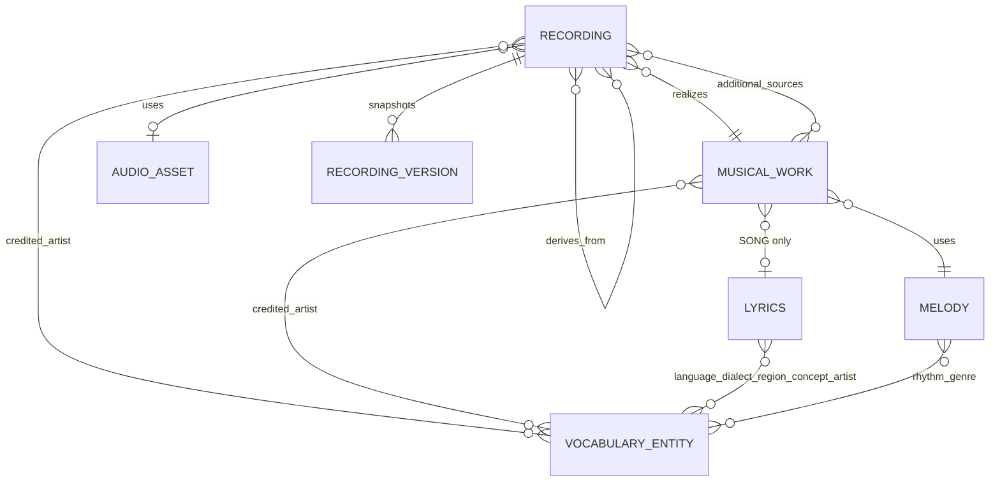

# Khalil Music Archive ontology, version 1

## Audit — 28 October 2026

The existing Express/Mongoose API stores recordings in `ArchiveItem` (`archiveitems`). Categories and albums provide presentation groupings. Flat fields mix recording and composition metadata: `artist`, `trackClass`, `genre(s)`, `bpm`, `musicalKey`, lyrics language/concepts, audio and artwork references. There is no reliable work identity or artist-credit role. A Song cannot safely be inferred from its title, category, or language; neither can a production classification.

VP2 used the category/album catalog with a vinyl player. `ArchiveFooter` owns the persistent audio element, queue, playback state, equalizer, stem integration and lighting. It is deliberately retained. Existing authenticated Cloudinary uploads and local signed-preview/range delivery are reused. Admin access uses the existing `requireAdmin` middleware.

A read-only public API audit returned HTTP 200: **1 category, 1 album, 2 published recordings, 0 canonical work IDs**. This describes only publicly visible data. A direct read-only database audit could not connect (`MongooseServerSelectionError`); unpublished records and full legacy metadata have not been audited on the live database. No live migration, database modification or deployment was performed.

### Compatibility and ambiguity

- Persistent recording IDs, album/category IDs, URLs and original flat metadata remain intact.
- Existing public recordings are exposed as `ontologyStatus: UNMAPPED`, with null recording type and work, until reviewed. They continue to play. They are not silently relabeled Production or Music.
- Newly created recordings require a valid production type and exactly one primary work, even as drafts. Audio and optional metadata may remain incomplete in drafts.
- A Mix may reference several source recordings and source works. Its primary work must be explicitly chosen; the system does not claim that a multi-song mix is one of its component songs. A later `CompilationWork`/ordered-part model should be designed before changing primary-work cardinality.
- Public access still requires the recording, album and category publication gates. Canonical archived/withdrawn recordings are additionally withheld.
- Existing collection management remains available. Old recording update endpoints reject mapped recordings rather than bypassing ontology validation. Legacy creation endpoints return `MUSIC_ONTOLOGY_REQUIRED`; all new recordings must choose a primary work. Collection-tool recording creation/editing opens the new ontology editor. Legacy deletion uses the same transactional source-graph guard and refuses referenced source recordings.

## Domain model



Recording is the produced audio artifact. `MIX | REMIX | COVER | PRODUCTION` describes its workflow, independently of work classification or legal ownership. `SONG | MUSIC` describes the underlying work. Material inputs are lyrics, melody and attributed sources; formal relationships describe work and recording structure; efficient activities are represented through production credits/notes; the intended completed recording is the workflow output. These are not claims that a digital file is identical to philosophical purpose or that a remix automatically creates a new composition.

### Physical MongoDB schema

| Model | Identity and important fields |
|---|---|
| `ArchiveItem` | Existing `externalId`; additive `recordingType`, `workId`, `audioAssetId`, `recordingMetadata`, explicit credits, `sourceRecordingIds`, `sourceWorkIds`, `publicationStatus`, `archivalStatus`, `ontologyRevision`, provenance and version label. Old fields remain. |
| `MusicalWork` | Persistent `externalId`, `title`, `type`, required `melodyId`, Song-only `lyricsId`, explicit credits, description, revision and provenance. |
| `MusicMelody` | Persistent identity, canonical work BPM/key, rhythm and genre IDs, time signature, mode, melodic description, influences, field states and provenance. |
| `MusicLyrics` | Persistent identity, language/dialect IDs, region/concept IDs, role-qualified artist credits, text, script, translation references, notes, completeness, field states and provenance. |
| `MusicVocabulary` | Persistent identity, controlled kind, display name, normalized identity key, parent identity, ISO language code and description/provenance. |
| `MusicAudioAsset` | Persistent identity, uploaded URL, optional MIME/original filename and duration; media bytes remain in existing storage. |
| `MusicRecordingVersion` | Immutable recording snapshots, sequential revision, actor and timestamp. |
| `musicontologylocks` | Transactional source-graph serialization guard. |
| `musicontologymigrationbackups` | Per-run original document snapshots and expected post-migration revisions. |

Identity indexes are unique. Vocabulary uniqueness covers kind + NFKC/case/space-normalized name + parent, and nonempty ISO code per kind. Dialects must reference a valid language. Genres may reference a parent genre. A referenced entity's kind and parent identity cannot be changed. Rename its display metadata or create a separate identity. Metadata entities and musical works have no destructive delete endpoint.

Work edits create new Lyrics/Melody component identities by default, leaving prior components intact. API consumers can explicitly reuse `lyricsId`/`melodyId`. Editing one work therefore cannot accidentally mutate another work that reused a component. All recordings referencing an edited work see the updated work revision. Recording BPM/key never updates work BPM/key. Separate arrangement identities are not introduced in version 1; arrangement descriptions/credits and recording technical values remain explicitly scoped.

`MISSING`, `UNKNOWN`, `NOT_APPLICABLE`, and `SPECIFIED` are stored per metadata field. Empty arrays/nulls do not fabricate values. A Song without lyrics details remains a Song with incomplete Lyrics. Complete lyrics require text and a language. Music never carries Lyrics.

## Transaction and deployment requirements

Canonical writes use MongoDB transactions: deploy on a **replica set or sharded MongoDB**, such as Atlas. A standalone local mongod can serve existing reads but canonical writes return an explicit configuration error. This is required to keep references, recording snapshots and migration backups consistent and to serialize concurrent source-graph changes. Integration tests provision their own disposable single-node replica set.

Schema changes are additive. Mongoose establishes indexes during ordinary application startup; there is no automatic data conversion. Review production duplicate identities and backups before applying future index/schema changes. Deploy backend support before the frontend; the frontend retains the older catalog read path and explains an unavailable ontology editor on an older API.

## API contract

The authoritative vocabulary contract is `contracts/music-ontology.json`. The frontend copy and TypeScript declarations are in `src/lib/contracts/`; checksum tests guard the contract and compare sibling repository copies when available. Run `node scripts/sync-music-ontology.mjs` from the frontend after changing the backend contract. Zod validates strict write DTOs. Frontend recording validation rejects mismatched work identity/classification. The public catalog adds canonical `recordings` and augments compatibility `songs` with the exact same canonical projections. Audio URLs retain existing delivery/preview behavior.

Public prefix: `/api/music-ontology`; admin prefix: `/api/admin/music-ontology`.

| Method and path | Purpose |
|---|---|
| `GET /contract` (public) | Versioned enumeration/filter vocabulary |
| `GET /recordings[?filters]`, `GET /recordings/:id` | Hydrated recording/work/lyrics/melody model; public reads enforce publication gates |
| `GET /works`, `GET /works/:id` | Reusable work metadata; public reads only for works linked to visible recordings |
| `GET /vocabulary[?kind=&q=]`, `GET /vocabulary/:id` | Referenced vocabulary identities and search |
| `POST /recordings`, `PUT /recordings/:id` (admin) | Complete validated editor DTO; existing updates require revision |
| `DELETE /recordings/:id` (admin) | Revision-checked soft archive/withdrawal; keeps references and files |
| `GET /recordings/:id/versions` (admin) | Administrative recording revision history |
| `POST /works`, `PUT /works/:id` (admin) | Create/update reusable work; updates require revision |
| `POST /vocabulary`, `PUT /vocabulary/:id` (admin) | Controlled metadata creation/editing; updates require revision |
| Existing `/api/admin/music-archive/upload` | Authenticated audio/artwork uploads; no provider replacement |

Filters are canonical server fields: `q`, `recordingType`, `workType`, `language`, `dialect`, `region`, `concept`, `artist`, `lyricArtist`, `rhythm`, `genre`, `bpmMin`, `bpmMax`, `key`, `bpmScope`, and administrative statuses. Lyrics filters apply only to Song. `bpmScope=work` is the default; `recording` selects technical metadata. Genre/rhythm always refer to work Melody. Multiple matching relationships never duplicate a recording. No category-folder label is interpreted as a musical ontology value.

Publication requires a valid work, production classification, active archival status and uploaded audio. Optional musical metadata remains optional and explicitly incomplete. Credits require existing artist IDs and explicit roles. Self/cyclic source graphs, invalid references, stale revisions, nonpositive BPM, invalid key notation and dialect/language mismatches are rejected. All media references must pass existing owned-upload restrictions.

## Migration mapping and rollback

Run the read-only audit **against the intended database** before preparing the mapping:

```sh
node scripts/music-ontology-migrate.js audit
```

Create/review reusable works and controlled vocabulary in Admin first. One work ID may be reused by several recordings. An explicit reviewed mapping file contains:

```json
[
  {
    "recordingId": "existing-persistent-recording-id",
    "recordingType": "COVER",
    "workId": "reviewed-work-id",
    "credits": [{"artistId": "reviewed-artist-id", "role": "PERFORMER"}],
    "sourceRecordingIds": [],
    "sourceWorkIds": [],
    "note": "Reviewed classification and work attribution"
  }
]
```

| Legacy information | Mapping policy |
|---|---|
| `externalId`, title, media, artwork, collection | Retained; recording identity never replaced |
| `trackClass`, category, description | No inferred production/work classification; explicit mapping required |
| Artist string | Retained verbatim on old document; canonical artist credits require reviewed identities/roles |
| Legacy BPM/key | Copied only into recording-specific metadata if valid; ambiguous/unrecognized values remain in original fields and are flagged unknown canonically |
| Legacy language/genres/lyrics fields | Retained verbatim; not automatically attributed to a work |
| Published without audio | Becomes an explicit draft on reviewed migration; no playable public item is silently deleted |
| Missing work | Remains unmapped/playable through compatibility reads until reviewed |

Dry runs do not write. Apply is an explicit operator action:

```sh
node scripts/music-ontology-migrate.js migrate reviewed-mapping.json --run-id reviewed-20261028
node scripts/music-ontology-migrate.js migrate reviewed-mapping.json --run-id reviewed-20261028 --apply
node scripts/music-ontology-migrate.js rollback reviewed-20261028
node scripts/music-ontology-migrate.js rollback reviewed-20261028 --apply
```

Each recording's migration and original snapshot are committed in one transaction. A run may be partially applied if a later recording fails; use its run ID to inspect and roll back committed records. Rollback refuses records edited since migration and restores exact original documents only when the expected revision still matches. Works, component identities, audio asset descriptors and bytes are retained on rollback so shared/recoverable data is never destroyed. No migration has been applied to live data.

## User interfaces and synchronization

Admin is recording-first, with combined canonical filters, a guided five-step recording editor, reusable work editing, controlled metadata CRUD, hierarchical details, revisions and retained collection tools. Artwork has a crop/pan preview before uploading. New recordings can be saved as drafts without audio.

VP2 keeps immediate playback controls, vinyl artwork, timeline, volume, equalizer and stems. It adds a recording browser, scoped filters, work identity and progressively disclosed Lyrics/Melody metadata. Music has no empty Lyrics section. The existing persistent footer audio element owns playback; selecting metadata or filtering does not replace its queue. Queue controls reorder/remove queued items while preserving the currently playing recording. Current recording removal is disabled.

Admin saves invalidate the in-tab catalog and announce changes. Focus and 30-second revalidation propagate changes across tabs/clients; reads use `no-store`. Last successful browsing data is retained on temporary metadata failures. Metadata requests are independent from audio admission. `/api/music-archive/playback` is a lightweight projection of the same persisted recordings; it never hydrates works/taxonomies. The persistent player and local audio range-delivery authorization use this projection so a work-metadata lookup cannot gate audio loading. A published recording withdrawn by an administrator is removed from subsequent validated playlist refreshes.

## Verification

```sh
# backend: pure validation + isolated real MongoDB/HTTP + legacy archive/storage checks
node --test test/music-ontology.test.js test/music-ontology.integration.test.js test/music-archive.test.js test/music-archive-files.test.js
# frontend contract + existing playback helpers
node --test src/lib/musicOntology.test.js src/lib/archiveSearch.test.js src/lib/musicPulse.test.js src/lib/audioEqualizer.test.js src/lib/stemMix.test.js src/lib/songPerformance.test.js
npm run build
# frontend, from khalil-front; requires local mongod, Chrome and Playwright
node scripts/verify-music-ontology.cjs
```

The browser verifier uses a disposable MongoDB replica set and actual API, creates a draft through Admin, edits a shared work, plays a generated WAV through the existing player, checks playback continuity while exploring/filtering, and captures desktop/mobile layouts. No real account, production database or uploaded file is used. Evidence is under frontend `artifacts/music-ontology-20261028`.
